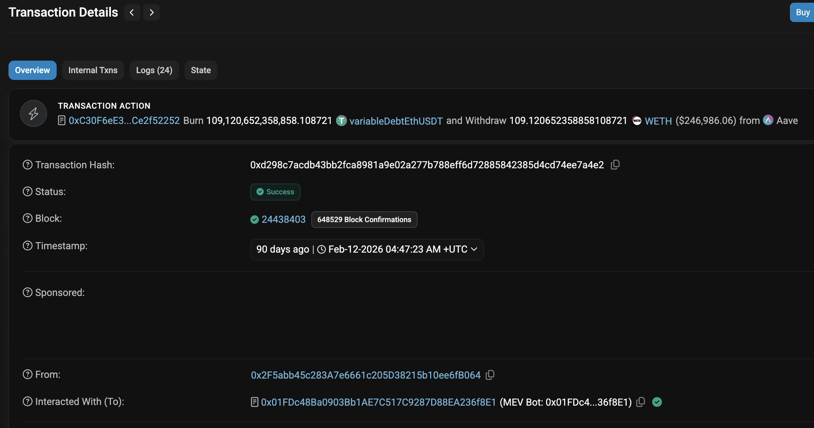
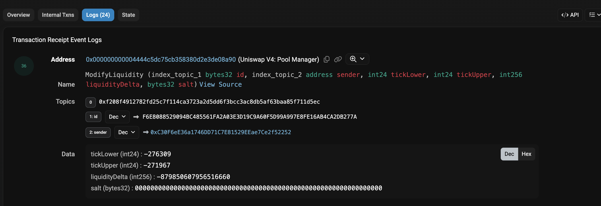
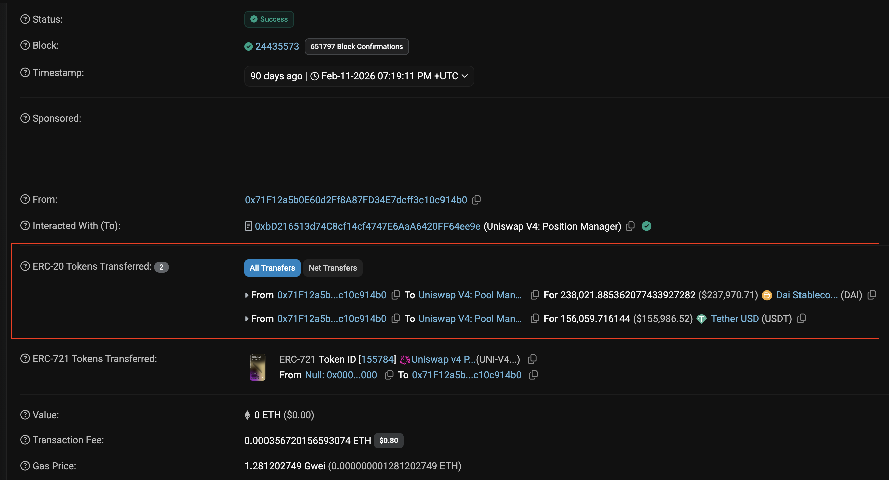
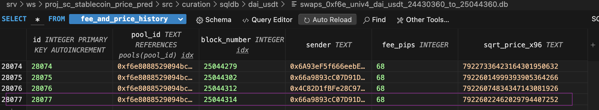
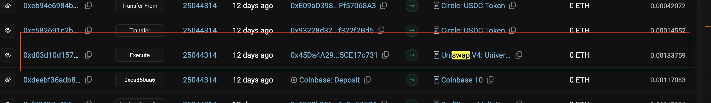
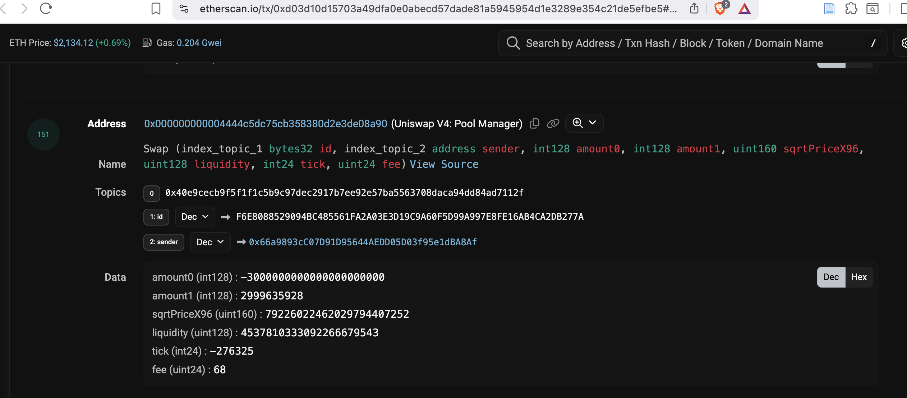
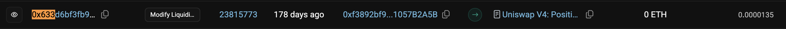
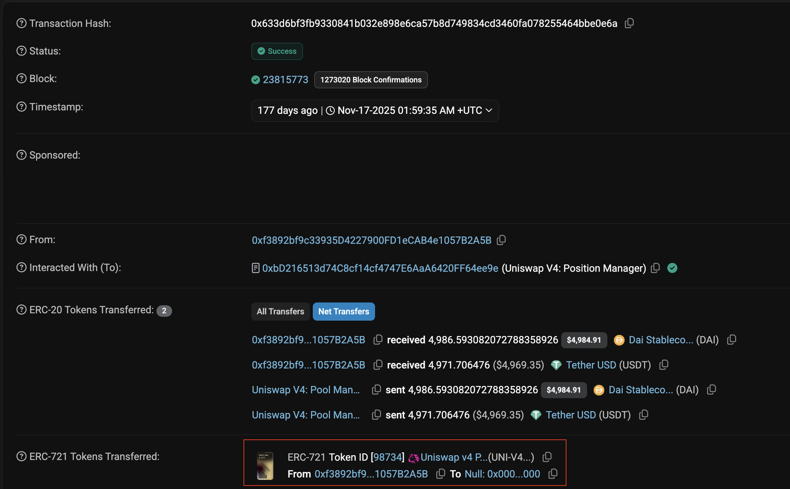
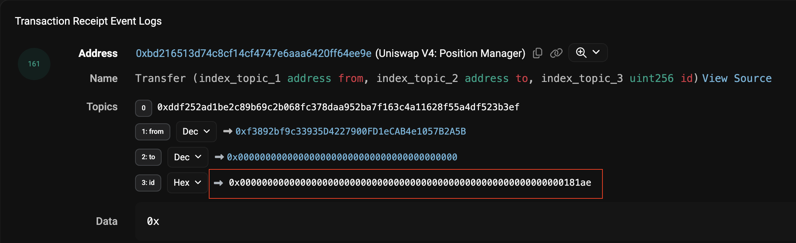

# Liquidity Positions in Uniswap V4
## Concepts
### Pool Manager
The pool manager in Uniswap v4 is a smart contract to facilitate token swaps. It serves as a single entry point for all liquidity pools. The pool manager is a Singleton that encapsulates the state and logic, so there is no need to deploy separate contracts for each liquidity pool.

The Uniswap v4 PoolManager was deployed at block 21688329.

See Uniswap [pool manager developers' docs](https://developers.uniswap.org/docs/protocols/v4/concepts/poolmanager) for design details.

### Position Manager
A smart contract that serves as the user interface for creating, modifying, and removing liquidity positions. The position manager provides a command-based system to interact with the PoolManager for managing liquidity, token transfers, and NFT minting. Each unique liquidity position as an ERC-721 Non-Fungible Token.

### Salt
A salt is an optional parameter used when creating a liquidity position to differentiate positions with the same price range in the same pool. 

### Managing Liquidity

The lifecycle of liquidity position consists of:
1. Minting: The creation of a new ERC-721 liquidity position in a specific pool and tick range.
2. Increasing liquidity: The process of adding more tokens to an existing position. When liquidity is increased, the fee revenue is automatically credited.
3. Decreasing liquidity: The removal of tokens from an existing position. Fee revenue is automatically debited. 
4. Calculate LP fees: The dynamic fees feature in V4 allows swap fees to be directly accrued to liquidity positions and can be further handled by hooks at ***afterModifyLiquidity***.
5. Burn position: A cost effective way to exit as a liquidity provider. Two actions are required: 
    i. Burn operation: to clear a position entirely and wothdraw funds.
    ii. Take pair: to send withdrawn funds to the recipient. 

## Extracting lifetimes of LPs from event logs
Extracting the lifetime of positions in Uniswap v4 from an archive node involves a three-step cross-reference of event logs:

1. **Find all Pools**: Identify all currency1-currency2 pool instances (different fees/hooks).
2. **Link Positions**: Map PoolIds to specific Position IDs.
3. **Trace Lifetime**: Find the block where the NFT was minted and the block where it was burned (or the current block if active).

### Modify Liquidity
V4 uses a salt in the core ModifyLiquidity event that can be used to link the core pool activity to the liquidity position lifecycle.

The ModifyLiquidity event appear within the internal transactions present in a given block. 

<div align="center">
    
</div>

In Uniswap v4, the ModifyLiquidity event is defined as:
```
event ModifyLiquidity(PoolId indexed id, address indexed sender, int24 tickLower, int24 tickUpper, int256 liquidityDelta, bytes32 salt);
```

As only the id and sender are indexed, the remaining properties are packed into the data hex string as 32-byte (64 character) words. To extract the tickLower and tickUpper from the ModifyLiquidity event, the data field of the log can be sliced.

<div align="center">
    
</div>

The above logs can be viewed in [Etherscan](https://etherscan.io/tx/0xd298c7acdb43bb2fca8981a9e02a277b788eff6d72885842385d4cd74ee7a4e2#eventlog).

The swapped tokens can also be found in the transaction logs under token transfers, [an example](https://etherscan.io/tx/0x92cace996e63cef735e9c5e9fbf87711a1d90e5ed9b53cb19b1eca4a6c8acde4) is shown below.

<div align="center">
    
</div>

### Swaps

The Pool Manager contract manages swaps within a liquidity pool. The signature of a SWAP event can be used to extract them from the event logs:
```
event Swap(
        PoolId indexed id,
        address indexed sender,
        int128 amount0,
        int128 amount1,
        uint160 sqrtPriceX96,
        uint128 liquidity,
        int24 tick,
        uint24 fee
    );
```

The following table shows the swap fees and prices curated from event logs.

<div align="center">
    
</div>

The corresponding event log can be viewed in Etherscan as follows:
1. Go to the the spefic block number, e.g. [28077](https://etherscan.io/block/25044314)
2. Click transactions link.
2. Locate the transaction.

<div align="center">
    
</div>

3. Find the relevant [event log](https://etherscan.io/tx/0xd03d10d15703a49dfa0e0abecd57dade81a5945954d1e3289e354c21de5efbe5#eventlog) for the swap.

<div align="center">
    
</div>

### Exiting Position

When exiting a liquidity position, the position manager contract emits a TRANSFER event, which is same as the transfer event associated with ERC-20 token swaps
```
Transfer(address indexed from, address indexed to, uint256 value)
```
The activity is recorded in the normal [transactions logs](https://etherscan.io/txs?block=23815773&sort=desc&p=3) (not internal)

<div align="center">
    
</div>

The ERC-721 tokens are transferred to the zero address, as highlighted in the Figure below.

<div align="center">
    
</div>

Additionally, the salt associated with the liquidity position, which was generated when the position was created, can be used to differentiate the transactions for "exit" events from other swaps. An example can be found in [these logs](https://etherscan.io/tx/0x633d6bf3fb9330841b032e898e6ca57b8d749834cd3460fa078255464bbe0e6a#eventlog), as also shown in the below Figure.

<div align="center">
    
</div>

### Fee Tier
A percentage of the liquidity provider (LP) fee is applied to swaps in a liquidity pool. This percentage is called a fee tier. The fees are automatically distibuted equally among all the participating liquidity providers. The LPs can collect earned fees without removing the liquidity from the position. There are unlimited number of fee tiers in V4.

### Tick Ranges
A tick defines a price interval. It is the smallest area where a liquidity can be placed. Another name for ticks is basis points, known as bps or "bips." There is a tick for every price 1.0001n, where n is an integer. This is the number generally seen quoted on exchanges and data sources. This would be the price of 1 TOKEN0 relative to 1 TOKEN1.

An example of pricing TOKEN0 relative to TOKEN1 is described [here](https://support.uniswap.org/hc/en-us/articles/7423663459597-Why-does-the-price-input-automatically-round).

### Dynamic fees

Dynamic fee is a mechanism provided in V4 to adjust swap fees in real-time using hooks. The intention is to improve liquidity provider profitability and overall market efficiency.

In Uniswap v4, dynamic fees are updated by hooks, but the actual fee paid is recorded in the Swap event. To see how these fees impact position lifetime (e.g., do LPs stay longer in high-fee environments?), the "yield" generated by a pool can be aggregated during the time a position was active.

The dynamic fee capability of a pool is determined at pool creation and is immutable. For pools that do use dynamic fees, two methods for updating the fee are supported:

1. By calling the updateDynamicLPFee function on the PoolManager contract at specified intervals.
2. By returning the fee from the beforeSwap hook. This allows hooks to override the LP fee for each swap in dynamic fee pools.

The optimal fee depends on at least two factors: asset volatility and volume of uninformed flow. Uninformed flow (or noise trading) refers to orders in financial markets placed by participants—often retail traders—who lack private information about asset values.

### Impermanent Loss
The temporary loss of funds experienced when providing liquidity compared to simply holding the tokens, caused by volatile price changes. However, high trading fees earned in the pool can offset or exceed this loss.

When the price of tokens in a pool changes relative to when they were deposited, arbitrageurs rebalance the pool, resulting in the liquidity provider holding more of the asset that has dropped in value. To minimize the impermanent loss: 

* Use stablecoin pairs as they have lower risk of price divergence. 
* Use correlated asset pairs that move together, reducing the magnitude of price divergence. 
* Offset the loss by concentrating liquidity within a specific price range, which can increase fee income.

## Research Questions

#### Are the survival times of liquidity positions longer for token pairs containing at least a stablecoin?

In a stablecoin pair, most liquidity is concentrated around tick 0. Narrow Ranges (e.g., -2 to +2 ticks) earn massive fees but are highly sensitive to "depegs." Wide Ranges (e.g., -100 to +100 ticks) are safer but earn less. By including tick_lower and tick_upper, a Quantile Regressor model can calculate the Range Width:

$Width$ = $tick$<sub>upper</sub> - $tick$<sub>lower</sub>

This $Width$ is a powerful feature for the Quantile Regressor. Usually, narrower ranges have shorter survival times because they require active management.

#### How to optimally adjust the dynamic fee of a liquidity position for given token pairs and expected volatility of their prices? 
Steps:
1. Compute price volatility of the tokens using statistical models.
2. Determine the optimal dynamic fee to maximize profit.
3. Implement hooks for fee collection.
4. Interpret the modeling uncertainty.


## Prerequisites & Addresses

PoolManager: 0x000000000004444c5dc75cb358380d2e3de08a90 

PositionManager (ERC721): 0xbd216513d74c8cf14cf4747e6aaa6420ff64ee9e 

DAI: 0x6B175474E89094C44Da98b954EedeAC495271d0F 

USDT: 0xdAC17F958D2ee523a2206206994597C13D831ec7

Deployment Block: 21688329